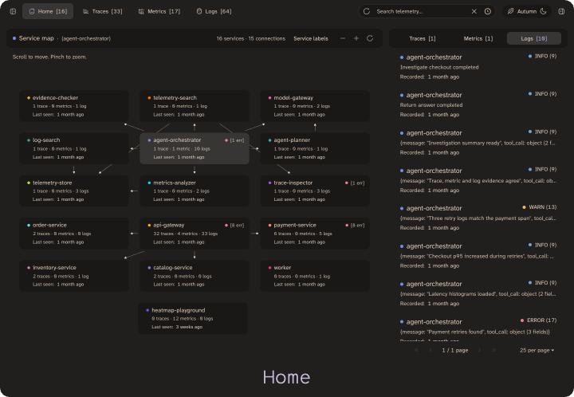
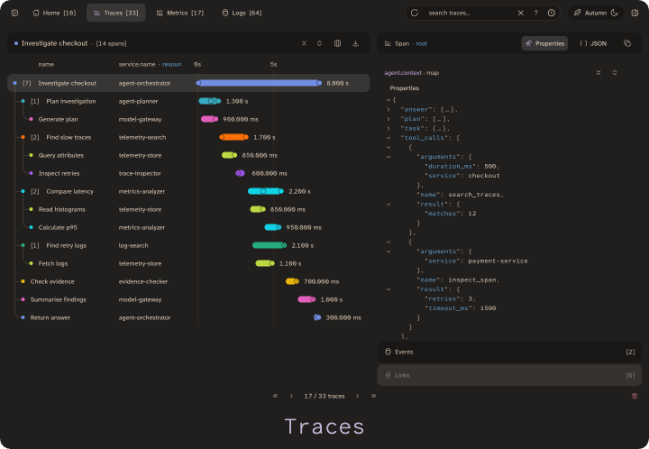
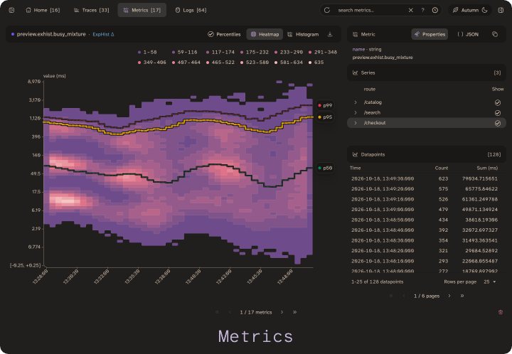
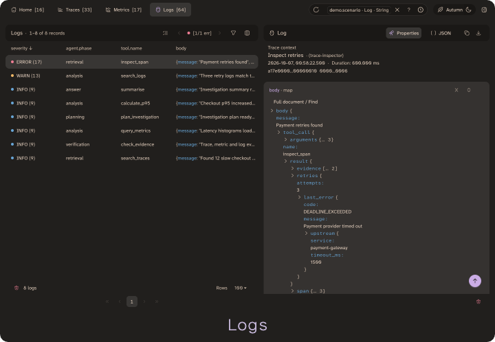
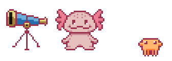

<h1 style="display: flex; align-items: center; gap: 12px;">
  
  otel-desktop-viewer
</h1>

`otel-desktop-viewer` is a local OpenTelemetry viewer for traces, metrics and logs. It packages an OpenTelemetry Collector, DuckDB and a browser-based interface into a single executable.

<p align="center">
  <a href="docs/screenshots/home.png"></a>
  <a href="docs/screenshots/traces.png"></a>
</p>
<p align="center">
  <a href="docs/screenshots/metrics.png"></a>
  <a href="docs/screenshots/logs.png"></a>
</p>

## 1. Install the viewer

<details>
<summary> GitHub Releases</summary>

Download the latest release for your platform:

| Platform | Architecture | Download |
| --- | --- | --- |
| macOS | Apple Silicon | [tar.gz](https://github.com/CtrlSpice/otel-desktop-viewer/releases/latest/download/otel-desktop-viewer_darwin_arm64.tar.gz) |
| Linux | x86_64 | [tar.gz](https://github.com/CtrlSpice/otel-desktop-viewer/releases/latest/download/otel-desktop-viewer_linux_amd64.tar.gz) |
| Linux | arm64 | [tar.gz](https://github.com/CtrlSpice/otel-desktop-viewer/releases/latest/download/otel-desktop-viewer_linux_arm64.tar.gz) |
| Windows | x86_64 | [zip](https://github.com/CtrlSpice/otel-desktop-viewer/releases/latest/download/otel-desktop-viewer_windows_amd64.zip) |

See [Releases](https://github.com/CtrlSpice/otel-desktop-viewer/releases) for release notes and older versions. Linux binaries require glibc 2.39 or newer.

</details>

<details>
<summary> Homebrew Cask</summary>

```bash
brew tap ctrlspice/otel-desktop-viewer
brew install --cask otel-desktop-viewer
```

</details>

<details>
<summary> Docker</summary>

```sh
docker run -p 8000:8000 -p 4317:4317 -p 4318:4318 ghcr.io/ctrlspice/otel-desktop-viewer:latest
```

See the [Docker guide](docs/docker.md) for ports, persistent storage, Docker Compose and image options.

</details>

<details>
<summary> <code>go install</code></summary>

Building the current source requires Go 1.26 and CGO. DuckDB 2 is statically
linked into the executable; a separate DuckDB installation is not required.

```bash
go version
go env CGO_ENABLED   # should print 1
gcc --version        # or cc --version
```

**On Windows**: Use a MinGW64 GCC toolchain compatible with DuckDB's prebuilt
static library. CI uses `C:\mingw64\bin`. Put the compatible toolchain first in
`PATH` and verify which compiler CGO will find. For that installation, in PowerShell:

```powershell
$env:PATH = "C:\mingw64\bin;$env:PATH"
(Get-Command gcc).Source
gcc --version
g++ --version
```

See [the build prerequisites](docs/CONTRIBUTING.md#prerequisites) for the supported
toolchain. Prebuilt release binaries do not need a compiler.

**On Linux/macOS**: the checks above are sufficient.

`@latest` resolves to the newest **stable** tag on the Go module proxy, not an alpha or beta release. Pin a version such as `@v0.3.0`, or use a [GitHub Release](https://github.com/CtrlSpice/otel-desktop-viewer/releases) binary to avoid compiling locally.

```bash
# install the CLI tool
go install github.com/CtrlSpice/otel-desktop-viewer@latest

# run it!
$(go env GOPATH)/bin/otel-desktop-viewer

# if you have $GOPATH/bin added to your $PATH you can call it directly!
otel-desktop-viewer

# if not you can add it to your $PATH by running this or adding it to
# your startup script (usually ~/.bashrc or ~/.zshrc)
export PATH="$(go env GOPATH)/bin:$PATH"
```

</details>

<details>
<summary>  apt / dnf</summary>

Stable releases include `.deb` and `.rpm` packages on [GemFury](https://gemfury.com/).

**Debian / Ubuntu:**

```bash
curl -fsSL https://apt.fury.io/ctrlspice/gpg.key | sudo gpg --dearmor -o /usr/share/keyrings/fury.gpg
echo "deb [signed-by=/usr/share/keyrings/fury.gpg] https://apt.fury.io/ctrlspice/ * *" \
  | sudo tee /etc/apt/sources.list.d/fury.list
sudo apt update
sudo apt install otel-desktop-viewer
```

**Fedora / RHEL:**

```bash
sudo tee /etc/yum.repos.d/fury.repo <<EOF
[fury]
name=Gemfury Repo
baseurl=https://yum.fury.io/ctrlspice/
enabled=1
gpgcheck=0
EOF
sudo dnf install otel-desktop-viewer
```

</details>

## 2. Configure your exporter

Your application needs OpenTelemetry instrumentation and an OTLP exporter. If its SDK supports environment variables, choose one of the following configurations before starting the application.

For OTLP over HTTP:

```sh
export OTEL_EXPORTER_OTLP_ENDPOINT=http://localhost:4318
export OTEL_EXPORTER_OTLP_PROTOCOL=http/protobuf
```

For OTLP over gRPC:

```sh
export OTEL_EXPORTER_OTLP_ENDPOINT=http://localhost:4317
export OTEL_EXPORTER_OTLP_PROTOCOL=grpc
```

See the [SDK configuration guide](docs/sdk-configuration.md) for more options and examples.

## 3. Start the viewer

By default, the viewer stores telemetry in memory, opens your browser at `http://localhost:8000`, and receives OTLP on `localhost:4317` (gRPC) and `localhost:4318` (HTTP):

```sh
otel-desktop-viewer
```

Telemetry stored in memory is lost when the viewer stops. Use `--db` to save it to a file, then start the viewer with that file to pick up where you left off:

```sh
otel-desktop-viewer --db ./telemetry.duckdb
```

## 4. Use the viewer

Choose your own adventure.

### 🧑‍💻 For humans

Open <http://localhost:8000> in your browser to view telemetry as it arrives from your application, or drag an OTLP JSON file onto the page to inspect saved telemetry.

### 🤖 For agents

1. Read CLI help for available commands and options:

   ```sh
   otel-desktop-viewer --help
   ```

   For help with a specific command, add `--help`:

   ```sh
   otel-desktop-viewer query --help
   ```

2. Read the bundled agent guide for instructions on connecting to the viewer and inspecting telemetry:

   ```sh
   otel-desktop-viewer skills
   ```

3. **Optional:** Install the [agent skill](skills/otel-desktop-viewer/SKILL.md):

   ```sh
   npx skills add CtrlSpice/otel-desktop-viewer --skill otel-desktop-viewer
   ```

The guide is also available at <http://localhost:8000/llms.txt> while the viewer is running.

## Documentation

- [Command-line options](docs/command-line-options.md) — viewer flags, defaults, storage and ports.
- [SDK configuration guide](docs/sdk-configuration.md) — send application telemetry and test your setup.
- [Docker guide](docs/docker.md) — images, ports, persistent storage and Docker Compose.
- [OTLP JSON export and import](docs/otlp-json-export.md) — file formats, downloads and browser imports.
- [Schema upgrades](docs/schema-migration.md) — database compatibility and migrations.
- [Collector secret redaction](docs/redaction.md) — data covered by ingestion redaction and its limits.
- [Architecture](docs/ARCHITECTURE.md) — components, storage, APIs and frontend behaviour.
- [Metric resolution](docs/metric-resolution.md) — how the viewer calculates metric chart data.

## What's with the axolotl?



Her name is **Lulu**. She is very pink, and I love her.

I commissioned [her original painting](docs/lulu.png) from the super talented [Chelsey Bateson](https://cbatesonart.artstation.com/), way back when the project was almost called AxolOtel. The terrible pun didn't survive, but Lulu stayed on as mascot on account of being cute af. We've iterated on her design since, and the pixel-art Lulu above is the latest version.

And because I would never run a joke into the ground, [Lulu belongs to the people](https://github.com/CtrlSpice/lulu): her pixel art is dedicated to the public domain under [CC0 1.0](https://github.com/CtrlSpice/lulu/blob/main/LICENSE).

Her crab friend is [fan art of Clawd](https://github.com/CtrlSpice/lulu/tree/main/fan-art), Anthropic's mascot.

## Contribute

See the [Contributor guide](docs/CONTRIBUTING.md). Please read our [Code of Conduct](docs/CODE_OF_CONDUCT.md) before participating.

## License

Apache 2.0, see LICENSE
