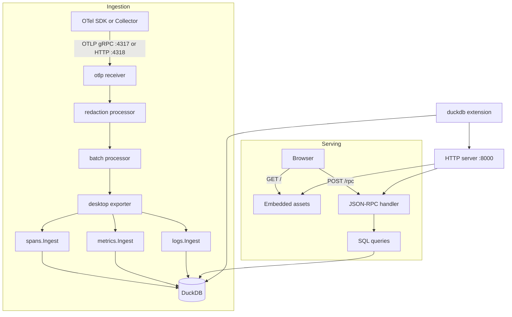

# otel-desktop-viewer architecture

otel-desktop-viewer is a custom OpenTelemetry Collector distribution. A
`desktop` exporter writes traces, metrics, and logs to DuckDB. A `duckdb`
extension owns the database, HTTP server, retention loop, and embedded Svelte
UI.

## System overview



| Port | Purpose |
| --- | --- |
| 4317 | OTLP gRPC |
| 4318 | OTLP HTTP |
| 8000 | Web UI and JSON-RPC |
| 3001 | Vite development server |

## Components

The binary uses these Collector components:

| Kind | Component |
| --- | --- |
| Receiver | `otlp` |
| Processor | `redaction`, `batch` |
| Exporter | `desktop` |
| Extension | `duckdb` |

The default pipelines are:

```text
traces:  otlp -> redaction -> batch -> desktop
metrics: otlp -> redaction -> batch -> desktop
logs:    otlp -> redaction -> batch -> desktop
```

The standard Contrib redaction processor masks configured secret patterns before
batching and storage, including browser OTLP telemetry file imports. See
[redaction coverage and policy](redaction.md).

The batch processor sends at 8,192 items or after 1 second. The exporter uses a
blocking sending queue with one consumer. Each write has a 30-second ingest
deadline.

The `duckdb` extension starts before pipeline components and stops after them.
It opens the store, starts the HTTP server and retention loop, then exposes the
store through the Collector extension map. Each exporter resolves that shared
store during `Start`.

Shutdown stops retention, stops HTTP serving, and closes the store. Store close
uses the shutdown context rather than waiting indefinitely for readers.

## Repository layout

```text
otel-desktop-viewer/
|-- main.go
|-- components.go
|-- desktopexporter/
|   |-- exporter.go
|   |-- duckdbextension/
|   `-- internal/
|       |-- server/
|       |-- store/
|       `-- frontend/
|-- scripts/
|-- Makefile
`-- docs/
```

The frontend build is committed under
`desktopexporter/internal/server/static/` and embedded with `go:embed`.

## Store ownership

`store.Store` has two DuckDB handles:

| Handle | Access | Purpose |
| --- | --- | --- |
| `driver.Conn` | `WithConn` | Ingest appenders |
| `*sql.DB` | `WithDBRead`, `WithDBWrite` | Queries, deletion, retention, checkpointing |

`WithConn` serializes ingest calls and takes the store read lock. Queries may run
at the same time as ingest. `WithDBWrite` excludes ingest and queries while a
pool mutation runs.

DuckDB appenders buffer rows until a flush or close. A query can therefore lag
ingest by one batch. Dictionary rows may become visible before their owner rows,
but read queries join from owners to dictionary entries and do not expose
unowned values.

Callers never receive the raw `*sql.DB`. Production code runs database work
inside a store closure so lock ownership covers the full operation.

## Schema

Schema objects live in `desktopexporter/internal/store/queries/ddl/`. Each
directory has an `_order` manifest because tables, indexes, and macros have
creation dependencies. Store startup verifies that every embedded DDL file is
listed exactly once.

The current schema version is 22. Store startup validates `schema_meta` before
running DDL. A mismatched, malformed, or unversioned telemetry database is
rejected without modification. The store does not migrate or reset databases.

### Tables

| Table | Stored data |
| --- | --- |
| `attributes` | Distinct typed attribute values |
| `resources` | Received Resource payloads |
| `scopes` | Received InstrumentationScope payloads |
| `spans` | Span records |
| `events` | Span events |
| `links` | Span links |
| `logs` | Log records |
| `metrics` | One exact OTel Metric identity |
| `metric_series` | One series for a Metric and datapoint attribute set |
| `metric_datapoints` | Gauge, Sum, Histogram, and ExponentialHistogram datapoints |
| `histogram_bounds` | Deduplicated explicit histogram bounds |
| `exemplars` | Metric exemplars |
| `ingest_rejections` | Refused record diagnostics |

`metrics.id` and `metric_series.id` are viewer-generated UUIDs. Public APIs call
them `metricRef` and `seriesRef`. `getMetricSeries` exposes `metric_datapoints.id`
as `datapointRef`; `getLog` exposes `logs.id` as `logRef`. These references are
scoped to one database. Received OTel trace/span identifiers remain `traceID`
and `spanID`.

Metric identity includes the complete Resource payload key, complete Scope,
Scope schema URL, name, unit, type, temporality where applicable, and
monotonicity where applicable. Description and metadata remain received Metric
fields but do not identify a Metric. `service_name` is a derived search and
display field from Resource attributes.

`metric_series` identifies one Metric plus one datapoint attribute set.
`metric_datapoints` keeps both `metric_id` and `series_id`, along with the exact
attribute IDs needed to render the datapoint.

### Values and precision

Attributes, log bodies, and Metric metadata use recursive tagged JSON. Every
value is `{kind,value}`.

- int64 values use decimal strings.
- finite doubles use JSON numbers.
- negative zero and non-finite doubles use exact IEEE-754 bit text.
- arrays preserve order.
- maps keep the last received value per key, then sort the surviving entry list.
- empty values use `null` inside the tagged value.

Received OTLP timestamps use DuckDB `UBIGINT`. Span kind, span status code, and
Metric aggregation temporality use signed `INTEGER`, including unknown values.
The API returns numeric codes with derived display labels.

Histogram and ExponentialHistogram `sum`, `min`, and `max` are nullable. NULL
means absent; zero means present zero. Histogram counts and bucket vectors use
unsigned 64-bit storage.

Optional parent, correlation, exemplar, and link target IDs remain NULL when
absent. The store does not invent zero IDs.

### Attributes

The attribute dictionary is keyed by a 128-bit prefix of SHA-256 over the key
and canonical tagged value. Owners store sorted UUID arrays. Identical typed
values deduplicate across owner categories. Each owner's attribute collection
keeps the last received occurrence of each key before encoding and hashing.
Selection is local to that collection: it never combines Resource, Scope, record,
event, link, datapoint, exemplar or metadata attributes. Earlier conflicting values
are not stored. The incoming pdata is not mutated.

DuckDB cannot enforce foreign keys into UUID arrays. Ingest writes dictionary
rows before owner rows. Store tests check for dangling references.

`ingest.SweepOrphans` removes dictionary entries with no owners. Clear operations
sweep immediately. Retention sweeps before measuring and after each prune round.
Single-entity deletes leave cleanup to the next clear or retention sweep.

Cross-signal correlation fields are not foreign keys. Logs and exemplars can
arrive before a span, after it, or without it. Link target IDs may point outside
the stored trace set.

## Ingest

Ingest reads OpenTelemetry pdata directly. It does not build intermediate Go
domain objects.

Each request uses two passes:

1. Encode and hash attributes, then resolve Resource, Scope, Metric, and series
   identities.
2. Append spans, logs, Metric datapoints, exemplars, events, and links.

The dictionary and identity tables use inserts with conflict handling. High
volume owner tables use DuckDB appenders.

## Query layer

Read queries are `.sql` files under `queries/spans`, `queries/logs`, and
`queries/metrics`. `go:embed` loads them at startup. `text/template` inserts only
named SQL fragments; values use bound parameters.

The query registry checks that every file has one Go name and every Go name has
one file. Golden tests cover rendered SQL.

Queries produce JSON with DuckDB functions and return `json.RawMessage`. The Go
server forwards those bytes without response structs or re-encoding.

Shared JSON shapes and numeric encoders live in SQL macros. Ordered arrays use
`to_json(list(value order by key))` so response order is explicit.

## Search

The frontend sends a query tree. Signal-specific mappers convert supported
fields and operators to parameterized SQL.

Built-in fields keep their native types. Received attribute keys keep exact
case and spelling. Explicit attribute references include owner scope, key, and
stored kind, for example:

```text
attr(span, "attempts", int64) > 2
```

Attribute equality can calculate the dictionary ID before querying and use
`list_contains(attribute_ids, ?::uuid)`. Other operators join the dictionary and
compare the stored value.

## Metric views

`get_metric_view.sql` computes chart data:

- M4 reduction for Gauge and Sum series;
- Delta and Cumulative histogram merges;
- requested quantiles;
- Sum, Average, and Rate views;
- sparklines;
- `Selected` and `All` cross-series aggregates.

Exact received integers and counts remain decimal text on the wire and become
frontend `bigint` values. Derived chart values use JavaScript numbers. See
[metric-resolution.md](metric-resolution.md) for the full contract.

## HTTP and JSON-RPC

The server exposes these routes:

| Route | Purpose |
| --- | --- |
| `POST /rpc` | JSON-RPC 2.0, with a 1 MB request limit |
| `GET /openrpc.json` | OpenRPC method descriptions, also returned by `rpc.discover` |
| `GET /llms.txt` | Agent guide, including HTTP discovery instructions |
| `GET /export/{signal}/{id}` | Store-backed OTLP JSON download |
| `GET /*` | Embedded frontend and client-route fallback |

The HTTP root advertises `/openrpc.json` and `/llms.txt` with a `Link` header.
Discovery uses existing method names. The document describes the `View` naming
convention once, without audience tags or aliases. OpenRPC is a
JSON-RPC description, not an OpenAPI description of HTTP routes. GET and HEAD
are supported for the document. Named/positional params, exact numeric input
rules and wire representations are described alongside each method. The two
variadic delete methods accept repeated positional IDs, not a nested array.

The server binds to `localhost` by default. CORS accepts HTTP and HTTPS origins
so the Vite development server can call `/rpc`.

### Methods

| Method | Result |
| --- | --- |
| `rpc.discover` | OpenRPC description of the JSON-RPC interface |
| `getImportConfig` | Configured OTLP HTTP import port |
| `query` | Read-only SQL rows |
| `discoverTelemetry` | Typed service groups, directed service connections, child-span evidence, attribute keys and value frequencies |
| `searchTraceSummaries` | Trace list summaries |
| `getTraceOverview` | Compact spans and trace-linked log summaries |
| `getTraceView` | Full trace display data |
| `getSpan` | One exact span with associated logs |
| `getTraceSpanCount` | Span count for one trace |
| `searchLogSummaries` | Log list summaries |
| `getTraceLogSummaries` | Log summaries carrying one trace ID |
| `getLog` | One complete normalized log |
| `searchMetricSummaries` | Metric list summaries |
| `getMetric` | Exact Metric identity and series catalogue |
| `getMetricSeries` | Exact retained datapoints for one series and window |
| `getMetricView` | Chart data for one Metric and window |
| `getMetricAggregateView` | Cross-series aggregate data |
| `getTraceAttributeDefinitions` | Trace attribute definitions |
| `getTraceAttributeDefinitionsByTraceID` | Attribute definitions for one trace |
| `getLogAttributeDefinitions` | Log attribute definitions |
| `getMetricAttributeDefinitions` | Metric attribute definitions |
| `searchAttributeMatches` | Attribute fields matching text |
| `getFieldValueCompletions` | Completion values for one field |
| `getStats` | Signal counts and store size |
| `clearTraces`, `clearLogs`, `clearMetrics` | Delete one signal |
| `deleteSpansByTraceID` | Delete traces by received trace ID |
| `deleteLogsByRefs` | Delete logs by viewer references |
| `deleteMetric` | Delete one Metric by viewer reference |

Named and positional parameters share one validation path. Time bounds use
nullable decimal nanosecond strings. `null` means unbounded.

Requests for missing entities return signal-specific errors. Invalid received
IDs and invalid viewer references return separate parameter errors. Caller
cancellation maps to `-32010` rather than an internal error.

## Service discovery

The CLI `services` command uses the read-only `query` RPC. Home uses
`discoverTelemetry`; both share query builders in `internal/discovery/`, with no
stored service entity. Groups retain the exact typed Resource `service.name` and
`service.namespace` values. An absent namespace equals an empty-string namespace;
an absent name remains distinct. Equal display text with different types does
not merge groups. Home carries the returned `serviceIdentity` into attribute
discovery and signal searches.

Each field is computed within the selected inclusive time window:

| Field | Source and formula | Unit / precision |
| --- | --- | --- |
| `traceCount` | Distinct trace IDs among qualifying spans | Exact integer traces |
| `spanCount` | Number of stored spans, by composite trace/span identity | Exact integer records |
| `errorSpanCount` | Spans with received status code 2 | Exact integer records |
| `logCount` | Number of stored logs, independent of correlation IDs | Exact integer records |
| `errorLogCount` | Logs with received severity number 17–24 | Exact integer records |
| `metricCount` | Distinct `metrics.id` with qualifying datapoints | Exact integer Metric identities, not names or series |
| `dataPointCount` | Number of stored datapoints; histogram buckets/count do not multiply it | Exact integer records |
| `exemplarCount` | Exemplars belonging to qualifying datapoints | Exact integer records |
| `lastSeen` | Maximum span start, effective log time, or datapoint timestamp | Exact unsigned Unix nanoseconds, decimal string |

Effective log time is received timestamp, falling back to observed timestamp
when timestamp is zero. The same times determine window eligibility. `lastSeen`
is not ingestion time or proof of liveness. Signals aggregate independently before
joining Resource identity, avoiding multiplied counts. Instances/versions contribute
to the same typed namespace/name summary. CLI JSON includes resolved window bounds,
log severity bands and look-ahead truncation. The exact-name `--service` filter
spans all namespaces.

## Frontend

The Svelte 5 frontend uses TypeScript, Vite, Tailwind CSS, DaisyUI, bits-ui,
CodeMirror, and layerchart.

Routes are:

| Route | Page |
| --- | --- |
| `/` | Radial service map, contextual telemetry and typed attribute discovery, file import, storage and ingestion issues |
| `/traces`, `/traces/{traceID}` | Trace list and detail |
| `/logs`, `/logs/{logRef}` | Log list and detail |
| `/metrics`, `/metrics/{metricRef}` | Metric list and detail |

Route and time contexts own navigation and time selection. Pages own their data
requests and signal presentation state. URL updates use explicit push or replace
history modes.

`telemetry-service.ts` is the wire boundary. It sends JSON-RPC requests,
validates runtime payloads, converts exact integer text to `bigint`, decodes
tagged values, and maps wire types to domain types.

Metric aggregation remains in SQL. The frontend chooses tabs, colours, visible
series, chart coordinates, and selected datapoints. Legend changes request only
the aggregate envelope.

Signal pages poll `getStats` every 3 seconds for refresh indicators. Home loads
discovery and storage readings on entry, submitted search, time-range changes
and explicit refresh; it does not poll discovery. There is no push channel.

### Persistent workspace and sections

`App.svelte` owns one `WorkspaceShell.svelte`. Pages register content through
`PageLayout.svelte` and `contexts/workspace-context.svelte.ts` before the next
paint. Navigation and surviving pane containers stay mounted across routes.
Pane identity follows the optional List, required Main and optional Details roles.
One app-wide set of saved side-pane widths and open preferences applies across
signals. An omitted pane gives its space to Main without changing its saved
preference; responsive clamping changes only rendered geometry. Destination
geometry applies immediately, including loading, empty and error states.
All pane and section headers use one row, with controls beside the title and
the service-colour dot before it. Headers expose horizontal scrolling when
their controls cannot fit. Metric chart headers omit the
repeated Start/End range; the global time selector and chart axes supply time context.

`DetailStack.svelte` and `DetailBubble.svelte` share disclosure and sizing across
Home and signal Details. The available primary section stays open. Open sections
share height; closed available sections and then inactive sections dock below
them. Non-first open headers resize the boundary above; clicks toggle disclosure,
and keyboard resizing includes `0` to reset sizes. Stable keyed sections retain
focus, scroll and JSON folds when regrouped. Closed sections do not donate resize
space; drag-induced collapse commits on release.

### Home discovery and search

`HomePage.svelte` presents Getting started in List, service cards as graph
nodes in Main, and contextual Telemetry in Details. Lulu and the file-drop control
sit above the left section stack. The primary, headerless guide contains exporter
configuration and an `otel-cli` example; Storage and Ingestion issues are siblings.
HTTP configuration uses the received import port. The gRPC example identifies its
default port. Joined terminal containers have one enclosing border and use
Madoromi's Kami for code and Chitsu for their tab/tool bars, with Sumi text and
the shared syntax colours. Header tabs switch their selected fill immediately,
without a sliding indicator.
The left pane uses a compact welcome and import target, with aligned guide edges.
Without saved section sizing, the guide has the largest default weight and each
utility section opens with a compact initial share. Closed headers stay compact;
saved resizing takes precedence.

The workspace, List/Details bodies, navigation and pagination share a uniform
Kami background. Resting signal-list and Details cards are transparent;
service-map nodes retain their Panel surface.
Labelled headings and input fields use Hyoshi; code toolbars use Chitsu.
Inputs and floating menus have quiet Nijimi
boundaries; composite search/date fields have one outer boundary and focus ring.
Cards use flat hover/selection fills, without hover shadows. See the frontend's
[theme mappings and upstream sources](../desktopexporter/internal/frontend/src/themes/README.md#surfaces-and-readable-text).
Issue links reveal the left pane and section.

Each service appears once as a three-row card: identity and errors, signal counts
separated by middle dots, then Last seen. Cards use the theme's Panel surface and
retain independent colour controls. Services without recorded connections remain
visible; layout ancestry alone never creates an edge. The footer's **More services**
appends the next 100-item page without removing existing nodes.

Selecting a card shows its Telemetry without moving the map or repeating the
service summary in Details. New neighbours occupy free space without moving
existing nodes. A new search/time scope or refresh starts a new layout. Reset view
restores the top-aligned graph overview at the default zoom, independently of
the inspected service. Selecting a directed connection
shows its counts and 25-item pages of recorded child spans, each linking to its
exact trace and span.

The map uses LayerChart's Dagre layout utility for top-to-bottom connected flows
and routed edges. Component packing places standalone cards alongside flows when
space permits, or below them on narrow views. Measured card dimensions determine
spacing and arrow endpoints. Cycles, reverse edges and shared dependencies retain
their recorded direction without duplicating service nodes.
It automatically loads the first 100 connections for
each loaded service, and for a newly inspected neighbour. **More connections**
continues a truncated result for the inspected service. The initial layout waits
for the first connection requests and opens at readable card size near the top
of the map; later discoveries preserve positions and zoom.
Scroll, drag empty space or use arrow keys on focused items to pan. Pinch,
Ctrl+wheel and the header buttons zoom. Card text and colour pickers retain
native selection and scrolling. Exact typed service
identities, including namespaces, distinguish nodes.

`discoverTelemetry` kinds `connections` and `connection-spans` follow recorded
parent span IDs within the same trace. Both endpoints must exist and satisfy the
trace search and time window. Names, timestamps, same-service references and
missing parents do not establish cross-service edges. `connections` requires
`serviceIdentity` and returns incoming and outgoing directed aggregates with
source/target service summaries, child-span count, distinct trace count and error
child-span count. `connection-spans` also requires `targetIdentity` and returns
the exact child spans for that source-to-target direction. Both use the shared
bounded `limit`/`offset` contract; nanosecond timestamps remain decimal strings.

`components/home/home-search.ts` projects the shared typed search tree onto each
signal. An inapplicable condition is false for that signal, retaining AND/OR
semantics. `discoverTelemetry` applies predicates and the time window before
grouping and paging; matching navigation totals cover all pages. Services use
100-item pages. The discovery API identifies attributes by key, stored kind and owner scope. Value
coverage pools distinct span, log and datapoint counts across applicable signals.
The denominator counts records carrying the key in that owner scope, across
stored kinds; percentages use the pooled counts rather than averaging percentages.
Each typed attribute heading counts distinct records carrying that key and kind;
multiple values of the same kind on one record do not inflate its heading count.

Home Telemetry shows signal summaries scoped to the inspected service, search
and time range. Metric search selects Metric identities, following the metric
workspace's query-membership semantics.
Log cards keep body previews on one ellipsized line, with the preview on hover
and the complete received body available in Details.

Tabs beside the Telemetry title offer Traces, Metrics
and Logs with known matching counts. Each signal keeps its own page and scroll position. Only the
active list scrolls; the footer offers 25, 50 or 100 cards per page and remembers
the choice. Signal changes are immediate and support arrow/Home/End keys.
Confirmed-empty or inapplicable signals are disabled; loading and failed signals
remain accessible. Service, search, time-range and refreshed
result changes reset paging and scroll without toggling other Home sections.

### Themes and data presentation

The appearance group selects Ink, Season and Day/Night. Madoromi supplies eight
seasonal variants with backgrounds at 20% of source OKLCH chroma. The default is
To-ro with Autumn and the system's initial Day/Night preference. Saved choices
take priority. Accent and count inks restore independently; selecting a global
ink also sets the count ink, which the chart picker can subsequently override.
Service/series assignments use 224 fixed categorical shades from 32 inks and
remain independent of interface themes. See [chart-palettes.md](chart-palettes.md)
and the [theme reference](../desktopexporter/internal/frontend/src/themes/README.md).

Shared typography uses regular-weight Atkinson Hyperlegible Next for interface
text and formatted values, and Mono for JSON, search and code: 14px working text,
16px page/pane headings and 1.5 line-height at the default root size. Home's 22px
welcome title is a display exception. Keys and helper text use Subtle; data uses
Text; type/provenance metadata uses Secondary. Display formatting, folding,
wrapping and identifier truncation preserve received types and exact values.
Copy is explicit and complete; raw JSON and Download retain source values rather
than formatted previews. Shared formatting lives in
`components/shared/detail-value.ts` and `components/shared/utils/editor-highlighting.ts`
under the frontend's `src/` directory.

## Trace view wire format

`getTraceView` sends Resources and Scopes once in top-level maps. Spans refer to
them by sequence key. Sequence values are stable within one database and are not
reused after deletion.

The response stores one absolute `traceStart`. Each span carries a start offset
and duration. `traceStart` is the minimum span start in the response, which
handles traces without roots and clock skew between hosts.

The frontend replaces a trace as one unit per fetch. It does not merge offsets
from responses with different baselines.

## Development

```text
Terminal 1: make run-go
Terminal 2: make dev-ts
Browser:    http://localhost:3001
```

Use `make build && ./otel-desktop-viewer` for an embedded production build.
Public builds exclude Evals. `make build EVALS=1` selects its Go implementation
and separate frontend assets; both variants retain the same database schema and
shared telemetry functionality. See [Experimental features](experimental-features.md).

## Related files

- Collector wiring: `main.go`, `components.go`, `desktopexporter/exporter.go`
- Store owner: `desktopexporter/duckdbextension/`
- Server: `desktopexporter/internal/server/`
- Storage: `desktopexporter/internal/store/`
- Frontend: `desktopexporter/internal/frontend/`
- Build and release: `Makefile`, `Dockerfile`, `.goreleaser.yaml`
