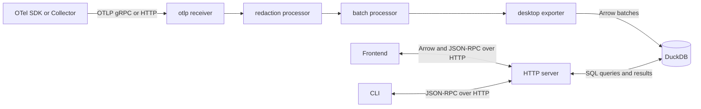

# Architecture

## Data flow

The viewer is one Go executable containing an OpenTelemetry Collector, DuckDB
and a Svelte frontend. The HTTP server serves the frontend to the browser and
handles its data requests.

## Code map

Start here when following data through the code.

| Responsibility | Entry points |
| --- | --- |
| Startup and CLI commands | [`main.go`](../main.go), [`root_command.go`](../root_command.go) |
| Collector pipelines and components | [`collector_config.go`](../collector_config.go), [`components.go`](../components.go) |
| Database, server and retention lifecycle | [`desktopexporter/duckdbextension/extension.go`](../desktopexporter/duckdbextension/extension.go) |
| Telemetry ingestion | [`desktopexporter/exporter.go`](../desktopexporter/exporter.go) |
| Database access and query packages | [`desktopexporter/internal/store/`](../desktopexporter/internal/store/) |
| HTTP routes | [`desktopexporter/internal/server/server.go`](../desktopexporter/internal/server/server.go) |
| Frontend pages and layout | [`desktopexporter/internal/frontend/src/App.svelte`](../desktopexporter/internal/frontend/src/App.svelte) |
| Frontend data requests | [`desktopexporter/internal/frontend/src/services/telemetry-service.ts`](../desktopexporter/internal/frontend/src/services/telemetry-service.ts) |

## Ingestion

All signals use the pipeline shown above. Frontend file imports use OTLP HTTP
and the same [Secret redaction](secret-redaction.md) policy.

- The `duckdb` extension starts the shared store and HTTP server before the
  pipelines. Both stay available until exporter queues drain.
- Exporters convert Collector `pdata` into typed Arrow batches.
  [`arrowbridge`](../desktopexporter/internal/store/arrowbridge/) passes them to
  DuckDB through a statically linked C extension.
- Batch transactions keep each accepted record and its nested data together.

## Storage

Each record keeps its received Resource (telemetry source) and Scope
(instrumentation library), along with its nested data.

| Table | Contents |
| --- | --- |
| `spans` | Span fields, attributes, events and links. |
| `logs` | Log fields, attributes and body. |
| `metric_records` | Received Metric descriptors, metadata, datapoints and exemplars. |

Views expose children as `events`, `links`, `metric_datapoints` and `exemplars`.
Definitions are in [`queries/ddl`](../desktopexporter/internal/store/queries/ddl/).

Span lookup needs received `traceID` and `spanID`. References can point to spans
that have not arrived or are no longer stored. Logs, metrics, series and
datapoints have opaque, viewer-generated identifiers.

### Metric identity and series

A metric's identity includes Resource and Scope, name, unit, type, and applicable
temporality and monotonicity. Description and metadata stay with received records
but do not affect identity. The `metrics` view selects the latest received
descriptor for each identity.

Within one metric identity, `metric_series` groups datapoints by their attributes.
For example:

| Datapoint attributes | Series |
| --- | --- |
| `{"method": "GET"}` | GET series |
| `{"method": "POST"}` | POST series |

Later datapoints with the same attributes join the same series.

### Values

Storage preserves the types and precision of received values.

- Attributes, log bodies and Metric metadata use `VARIANT` to keep types with
  nested values. JSON-looking strings remain strings.
- Timestamps and histogram counts use unsigned 64-bit integers; integer
  measurements use signed 64-bit integers.
- Optional fields retain absence, including histogram `sum`, `min` and `max`.
- Each attribute collection or nested map keeps the last received value per key,
  then sorts entries before encoding and hashing. A span's attributes and its
  Resource attributes remain separate.
- Arrays keep their order and repeated values.

### Database access

Queries can run alongside ingestion. `store.Store` controls access:

| Method | Use |
| --- | --- |
| `WithConn` | Ingestion on a dedicated connection, one writer at a time. |
| `WithDBRead` | Concurrent queries through the connection pool. |
| `WithDBWrite` | Deletion, retention and checkpointing, excluding queries and ingestion. |

Each method runs a callback under its lock. Database work must finish before
the callback returns.

[`retention.go`](../desktopexporter/internal/store/retention.go) enforces the
size cap by pruning old spans, logs and datapoints with their children.
Defaults and limits: [Command-line options](command-line-options.md).

## Queries

DuckDB filters and reduces data before sending it to the frontend.

- Query builders use templates in [`store/queries`](../desktopexporter/internal/store/queries/)
  and bound parameters. They apply time bounds, sorting and limits; lists use
  summaries, while selected records load complete values.
- [`store/search`](../desktopexporter/internal/store/search/) compiles search
  trees into SQL. Conditions keep the attribute owner, exact key and type.
  Two event conditions joined by AND must match one event; conditions on its
  span's Resource can match alongside them.
- [`store/searchindex`](../desktopexporter/internal/store/searchindex/) records
  values by owner, nested path and type for search and autocomplete. It updates
  in ingestion, deletion and retention transactions.
- DuckDB computes metric reductions, histogram merges, rates and quantiles.
  [Metric charts](metric-charts.md) defines the calculations and precision.

### Service discovery

Home and the CLI use [`internal/discovery`](../internal/discovery/) to group
services by the type and value of Resource `service.name` and `service.namespace`.

The service map draws parent-to-child service connections from recorded spans
in the same trace. Both spans must match the search and time range. Selecting a
connection shows its child spans.

## Transport

The frontend and CLI query the store through the HTTP server.

| Route | Purpose |
| --- | --- |
| `POST /api/data/{method}` | JSON parameters in, Arrow IPC datasets out. |
| `POST /rpc` | JSON-RPC for the CLI and frontend. |
| `GET /export/{signal}/{id}` | OTLP JSON downloads. |
| `GET /` | Frontend files, with fallback for client-side routes. |

Arrow requests contain parameters directly; RPC requests use a JSON-RPC envelope.
Both share parameter validation and query builders.

- **Arrow** carries frontend lists, details, charts and most discovery.
  `arrowbridge` reads native DuckDB batches;
  [`arrowread`](../desktopexporter/internal/store/arrowread/) converts `VARIANT`
  to standard Arrow types and writes binary IPC without converting data to JSON.
  The frontend validates the complete response, keeps its buffers and reads
  nested values on demand. It keeps 64-bit integers as `bigint`.
- **JSON-RPC** serves CLI queries and frontend statistics, deletion, some
  discovery and SQL lookups. SQL templates can construct JSON, which Go forwards
  without re-encoding. The `query` RPC accepts read-only SQL.
- **OTLP JSON** reconstructs records with their Resource and Scope, subject to
  [reconstruction limits](telemetry-files.md#reconstruction-limits).

API contracts are served at `/openrpc.json` and `/openapi.json`, including
numeric representations and the remaining HTTP routes.

## Frontend

Each Svelte 5/TypeScript page loads its data and tracks the selected records.

- One `WorkspaceShell` keeps pane containers mounted across routes.
  [`PageLayout`](../desktopexporter/internal/frontend/src/components/shared/PageLayout.svelte)
  and the [workspace context](../desktopexporter/internal/frontend/src/contexts/workspace-context.svelte.ts)
  fill three panes: List for lists and supporting controls, Main for charts,
  tables, timelines or service maps, and Details for selected records or connections.
  Side-pane widths and open/closed states are shared across signals.
- Route context handles navigation; time context tracks the selected range.
- The waterfall loads its tree and previews separately from full span Details.
  Charts lay out server-computed data and handle series visibility and selection.
- Shared components handle disclosure, resizing and record inspection; generated
  themes supply colours. Formatting and collapsed sections do not change stored
  or copied values.
- Copy and Download controls use complete stored values, including redactions
  applied during ingestion.

## Development

The [Makefile](../Makefile) builds frontend assets for Go to embed. Feature
inclusion is a build-time choice.

| Build | Frontend assets |
| --- | --- |
| `EVALS=0` (default) | Public app in `desktopexporter/internal/server/static/`; assets are committed. |
| `EVALS=1` | Public functionality plus experimental Evals, using separate assets. |

Both builds share the [database schema and migration chain](database-upgrades.md).
Startup checks compatibility before ingestion.

The [Contributor guide](CONTRIBUTING.md) covers setup, generated assets and checks.
