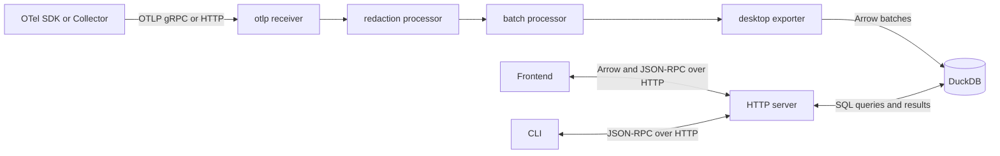

# Architecture

The viewer is one Go executable containing an OpenTelemetry Collector, DuckDB
and a Svelte frontend. The HTTP server serves the frontend to the browser and
handles its data requests.

## Collector lifecycle

[`collector_config.go`](../collector_config.go) builds the default configuration.
All signals use the same receiver, processor and exporter chain shown above.
The frontend sends file imports to the OTLP HTTP receiver. They pass through
the same policy described in [Secret redaction](secret-redaction.md).
[`components.go`](../components.go) registers the available Collector components,
including a file receiver that the default configuration does not activate.

The [`duckdb` extension](../desktopexporter/duckdbextension/extension.go) owns
the store, HTTP server and retention loop. It starts before the pipelines and
stops after their queues drain. Each [`desktop` exporter](../desktopexporter/exporter.go)
gets the shared store from the extension during startup.

Ingestion converts the Collector's `pdata` records into typed Arrow column
batches. The
[`arrowbridge`](../desktopexporter/internal/store/arrowbridge/) package passes
them to DuckDB through a statically linked C extension. Each accepted record
and its nested data stay together within a batch transaction.

## Storage

[`store.Store`](../desktopexporter/internal/store/store.go) controls database
access through three methods:

| Method | Use |
| --- | --- |
| `WithConn` | Ingestion on a dedicated connection, one writer at a time. |
| `WithDBRead` | Concurrent queries through the connection pool. |
| `WithDBWrite` | Deletion, retention and checkpointing, excluding queries and ingestion. |

Each method runs a callback while holding the required lock. Database work must
finish before that callback returns. Queries can run alongside ingestion.

### Records and identities

The main [tables](../desktopexporter/internal/store/queries/ddl/tables/) are:

| Table | Contents |
| --- | --- |
| `spans` | Spans with their Resource, Scope, attributes, events and links. |
| `logs` | Log records with their Resource, Scope, attributes and body. |
| `metric_records` | Received Metric records with their descriptors, context, datapoints and exemplars. |

Resource describes the telemetry source; Scope identifies its instrumentation
library. Each record owns its received Resource and Scope. SQL views expose
nested children as `events`, `links`, `metric_datapoints` and `exemplars`.

The `metrics` view selects the latest received descriptor for each logical
Metric. Identity includes Resource and Scope context, name, unit, type, and
applicable temporality and monotonicity. Description and metadata stay with each
received record but do not determine identity. In `metric_series`, each distinct
datapoint attribute set defines a series within one logical Metric.

Exact span lookup uses both received `traceID` and `spanID`. Logs, metrics,
series and datapoints have opaque viewer-generated references: `logRef`,
`metricRef`, `seriesRef` and `datapointRef`. Received `traceID` and `spanID` values
can refer to spans that have not arrived or are no longer stored.

### Values

Attributes, log bodies and Metric metadata use DuckDB's native `VARIANT` type,
which keeps types with nested values. Received timestamps and histogram counts
use unsigned 64-bit integers; integer measurements use signed 64-bit integers.
Optional fields preserve absence, including histogram `sum`, `min` and `max`.

Within each attribute collection or nested map, ingestion keeps the last
received value for each key, then sorts the surviving entries before encoding
and hashing. This never combines attributes from different owners. Arrays keep
their order and repeated values. Strings remain strings, including text that
looks like JSON.

OTLP downloads reconstruct the retained records with their owning context.
They preserve received values after ingestion processing, subject to the
[reconstruction limits](telemetry-files.md#reconstruction-limits).

### Schema and retention

The current schema and migration baseline are version 27. Schema definitions
live in [`queries/ddl`](../desktopexporter/internal/store/queries/ddl/), with
`_order` files specifying creation order. Startup checks database compatibility
before accepting telemetry. See [Database upgrades](database-upgrades.md) for
migration requirements and failure handling.

The extension periodically enforces the store's size cap through
[`retention.go`](../desktopexporter/internal/store/retention.go). Pruning removes
old spans, logs and datapoints with their owned child data.
Storage defaults and limits are in [Command-line options](command-line-options.md).

## Queries and APIs

Signal queries live in [`store/queries`](../desktopexporter/internal/store/queries/).
Go templates select SQL fragments; user values use bound parameters. Shared
query builders apply filtering, time bounds, sorting and limits before choosing
JSON or Arrow output.

The [HTTP server](../desktopexporter/internal/server/server.go) exposes:

| Route | Purpose |
| --- | --- |
| `POST /rpc` | JSON-RPC for the CLI and frontend. |
| `POST /api/data/{method}` | JSON parameters in, Arrow IPC datasets out. |
| `GET /export/{signal}/{id}` | OTLP JSON downloads. |
| `GET /openrpc.json` | RPC methods, parameters and result schemas. |
| `GET /openapi.json` | HTTP routes, media types and status codes. |
| `GET /llms.txt` | The bundled agent guide. |
| `GET /api/features` | Features available in this build. |
| `GET /` | Frontend files, with fallback for client-side routes. |

Arrow requests contain method parameters directly; RPC requests use a JSON-RPC
envelope. Both share parameter validation and query builders. The separate
`query` RPC accepts read-only SQL.

Arrow carries frontend lists, details, charts and most discovery results. Native
DuckDB query batches pass through `arrowbridge` to
[`arrowread`](../desktopexporter/internal/store/arrowread/), which converts
`VARIANT` values to standard Arrow types and writes the IPC response without
converting it to JSON. The frontend validates the complete response before
using it.

JSON-RPC serves CLI queries and frontend operations including statistics,
deletion, some discovery and SQL lookups. Signal SQL templates can construct
JSON directly; Go forwards those bytes without re-encoding. OpenRPC documents
each method's numeric representation.

Lists and charts use summaries or reduced data. Selected-record methods fetch
complete stored values, and Copy/Download use those values rather than previews.
DuckDB computes metric reductions, histogram merges, rates and quantiles;
[Metric charts](metric-charts.md) defines those calculations and their
precision. [Telemetry files](telemetry-files.md) covers file formats
and selection rules.

## Search and service discovery

Search text is parsed into a query tree, then compiled into parameterized SQL by
[`store/search`](../desktopexporter/internal/store/search/) and the signal query
builders. Attribute references retain the owner, exact key and stored type.
A match on a nested record uses that event or datapoint and its parent context;
values from sibling records cannot be combined.

[`store/searchindex`](../desktopexporter/internal/store/searchindex/) records
which Resource, Scope or record owns each searchable value, along with its
nested path and type. Text search and autocomplete use this catalogue.
Ingestion, deletion and retention update it transactionally with the telemetry.
Complete payloads remain in the native record tables.

Home and the CLI share service query builders in
[`internal/discovery`](../internal/discovery/). Services are grouped by typed
Resource `service.name` and `service.namespace` values. The service map draws
directed connections from recorded parent/child spans in the same trace, with
both spans present in the selected search and time range. Selecting a connection
shows the child spans behind it.

## Frontend

The Svelte 5/TypeScript app lives in
[`desktopexporter/internal/frontend/src`](../desktopexporter/internal/frontend/src/).
`App.svelte` selects the page and owns one shared `WorkspaceShell`. Pages fill
the List, Main and Details panes through
[`PageLayout`](../desktopexporter/internal/frontend/src/components/shared/PageLayout.svelte)
and the [workspace context](../desktopexporter/internal/frontend/src/contexts/workspace-context.svelte.ts).
Pane containers stay mounted across routes; saved side-pane widths and
open/closed states apply across signals. Route and time contexts own navigation and
the selected time range. Pages own their requests and record selections.

Home places Getting started, Storage and Ingestion issues in List, the service
map in Main, and selected service telemetry or connection details in Details.
The `/traces`, `/logs` and `/metrics` routes provide signal-specific workspaces.

[`telemetry-service.ts`](../desktopexporter/internal/frontend/src/services/telemetry-service.ts)
handles server requests. Its Arrow adapters retain response buffers and read
nested values on demand, preserving 64-bit integers as `bigint`. The trace
waterfall loads its tree and column previews separately from complete selected
span Details. Metric charts use the server's computed data; the frontend handles
coordinates, visible series and selection.

Shared components own section disclosure, resizing, value inspection and
Copy/Download controls. Theme generation supplies interface, syntax and graph
colours.
Display formatting and collapsed sections do not alter stored or copied values.

## Builds and development

The [Makefile](../Makefile) builds the frontend into
`desktopexporter/internal/server/static/`, which Go embeds in the executable.
Those public assets are committed. Feature inclusion is selected at build time:
`EVALS=0` is the public default; `EVALS=1` includes experimental Evals code and
separate frontend assets. Both builds share the database schema and migration chain.

See the [Contributor guide](CONTRIBUTING.md) for local setup, generated assets
and checks.
